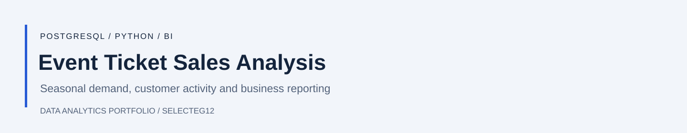
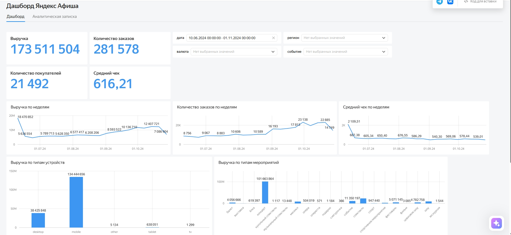

**English** | [Русский](README.ru.md)

# Event Ticket Sales Analysis

An analysis of ticket orders from **June to October 2024** using PostgreSQL, Python and DataLens. It looks at seasonal demand, customer activity, regions, ticket partners and devices.

[Notebook](research.ipynb) · [SQL queries](analysis.sql) · [Interactive dashboard](https://datalens.yandex/l4t1anvif4bm5?tab=mg)

## Dashboard

The dashboard is in Russian. The screenshot reflects its saved filters.

## What I analysed

- Revenue, orders, buyers and weekly trends from SQL extracts.
- Order records joined with event information and exchange rates.
- Differences between event categories, regions, ticket partners and devices.

In the processed sample, theatre and sports took a larger share of orders in autumn while the concert share declined. Around **53% of orders** came from the three largest regions, and most orders were placed on mobile devices.

These findings describe the supplied platform data. They do not show why demand changed or estimate shares of the entire ticket market.

## Data and reproduction

The source extract contains **290,849 orders**; the processed Python sample contains **214,408**. Cleaning and duplicate-handling rules affect the results. The SQL dashboard and Python notebook use different data slices.

`research.ipynb` contains preparation, exploration and statistical comparisons. It needs the original order, event and exchange-rate CSV exports under `/datasets`. `analysis.sql` contains the SQL extracts and calculations. Source data and a live PostgreSQL connection are not included.

Notebook outputs were cleared for the English version; that version has not been fully rerun.
