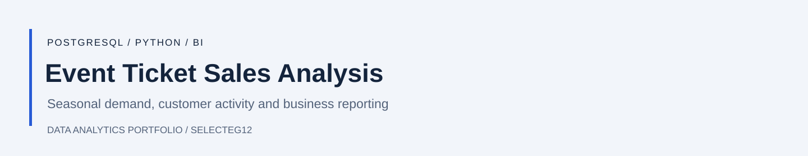
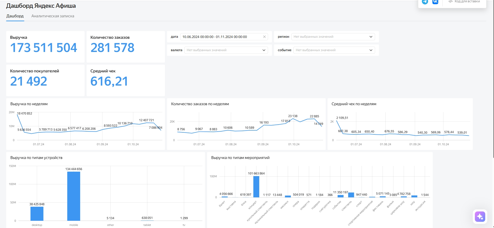

[English](README.md) | **Русский**

# Анализ продаж билетов

Анализ заказов билетов за **июнь — октябрь 2024 года** с помощью PostgreSQL, Python и DataLens: сезонный спрос, активность покупателей, регионы, билетные партнёры и устройства.

[Блокнот](research.ipynb) · [SQL-запросы](analysis.sql) · [Интерактивный дашборд](https://datalens.yandex/l4t1anvif4bm5?tab=mg)

## Дашборд

Дашборд на русском языке. Скриншот отражает сохранённые настройки фильтров.

## Что исследовано

- Выручка, заказы, покупатели и недельная динамика по SQL-выгрузкам.
- Заказы, объединённые с данными о событиях и курсами валют.
- Различия между категориями событий, регионами, билетными партнёрами и устройствами.

В обработанной выборке осенью выросла доля заказов на театр и спорт, а доля концертов снизилась. Около **53% заказов** пришлось на три крупнейших региона. Большинство заказов оформлено с мобильных устройств.

Выводы относятся к предоставленным данным платформы. Они не устанавливают причины изменения спроса и не описывают доли всего билетного рынка.

## Данные и повторение анализа

Исходная выгрузка содержит **290 849 заказов**, обработанная выборка Python — **214 408**. На результаты влияют очистка и обработка дубликатов. SQL-дашборд и блокнот Python используют разные срезы данных.

В `research.ipynb` находятся подготовка данных, исследование и статистические сравнения. Для запуска нужны исходные CSV с заказами, событиями и курсами валют в `/datasets`. В `analysis.sql` находятся SQL-выгрузки и расчёты. Исходные данные и подключение к PostgreSQL в репозиторий не входят.

Выводы ячеек очищены при подготовке английской версии; полный повторный запуск этой версии не выполнялся.
